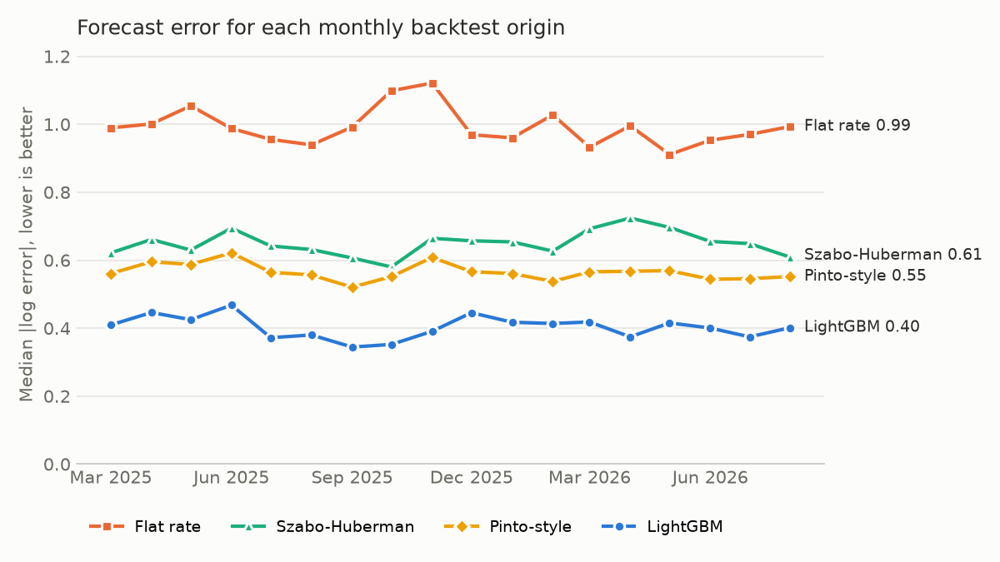

# first48

Predicts how many people will read a brand-new Wikipedia article in its first month, using only what is known in its first two days. Each forecast comes with a likely range, and articles likely to become top performers are flagged early, all tested on real public data against a published forecasting method.

## Results at a glance

Scored once on a final holdout of 23,199 articles created from August 20 to September 30, 2026, after training on 313,062 earlier articles:

- **Forecasts are typically off by a factor of 1.48**, against 1.72 for the best published method (a Pinto-style model) and 2.75 for extending day-1 views. That is 27.5% lower error than the best baseline, 95% CI for the difference 0.141 to 0.156 on the log scale, and LightGBM won all 18 monthly backtests against every baseline.
- **The day-2 flag is right more often than ranking by day-1 views.** At the same recall, 70.2% of flagged articles end up in the month's top 5%, against 62.2%.
- **The 80% ranges are slightly too wide overall and too narrow for the busiest articles.** They covered 83.6% of articles, just above the planned 77% to 83%, and 75.5% of articles with 100 or more day-1 views. This criterion is reported as missed.
- **Early views matter more than the text.** A model that only reads the article at creation is off by a factor of 1.84; adding the first two days of views brings it to 1.44.
- **The model holds up for a year without retraining.** Trained only on 2025, it lost 0.006 in median log error on 2026 articles compared with monthly retraining.



Every number comes from RESULTS.md, which is generated by `python -m first48.results` and names the command behind each figure.

## Why this problem

Content teams plan promotion, caching and staffing around expected demand, often before there is any history. Ranking by what is popular right now misses slow starters and overreacts to short spikes. New English Wikipedia articles are an open testbed for this cold-start problem: every one has a public creation time, public text and public daily pageviews.

Two decisions use the forecast, once per article, at the end of its first full day:
- Which new articles to give early attention (review, promotion, caching): a daily list of likely top-5% articles.
- How much total demand to expect from a day's new articles, with a range.

## How it works

1. **Data.** New articles from the MediaWiki creation and move logs, their daily views from the Wikimedia pageviews API (human traffic only), and their type from Wikidata. Cohorts from January 2025 to September 2026 are backfilled; new cohorts are collected daily by a scheduled GitHub Action. See notes/02_data_source.md.
2. **Warehouse.** Raw files load into DuckDB, plain SQL models build one row per article, and SQL data tests fail the build on duplicates, gaps or dropped articles (`python -m first48.warehouse`).
3. **Models.** Baselines from the early-popularity literature (flat-rate extrapolation, Szabo-Huberman with and without its variance correction, and a Pinto-style model on each day's views) and a log-linear model, against LightGBM on early views, timing, article type and edit activity in the first two days.
4. **Ranges.** LightGBM quantile models, adjusted with conformalized quantile regression so the 80% range holds its coverage.
5. **Flag.** The top 5% of each day's new articles by forecast, compared with the current practice of ranking by day-1 views.
6. **Validation.** Rolling monthly backtests where training only uses articles whose 30-day outcome was already known at the forecast date, then a final 6-week holdout scored once.
7. **Shadow mode.** A frozen model forecasts each live cohort before its outcome exists; forecasts are scored when the 30 days are up, and drift alerts open GitHub issues.

The question, metrics, splits and success criteria were fixed in PLAN.md before any modeling. Changes are logged as amendments.

## Reproduce

```bash
pip install -r requirements-analysis.txt
python -m first48.warehouse        # build data/first48.duckdb and run the data tests
python -m first48.backtest         # rolling backtests
python -m first48.intervals        # 80% ranges
python -m first48.flag             # day-2 flag
python -m first48.compare          # content only vs early views
python -m first48.dyk fetch 2025-01 2026-10   # Main Page "Did you know" features
python -m first48.dyk errors       # error for featured vs other articles
Rscript analysis/timing.R          # creation timing model
python -m first48.holdout          # final holdout, runs once
python -m first48.results          # writes RESULTS.md
python -m first48.chart            # writes the chart
pytest
```

Raw data is attached to the `backfill`, `backfill-2025`, `data`, `content`, `edits` and `dyk` releases.

## FAQ

**Why only the first two days?**
That is when decisions about new content get made. Waiting a week gives a better forecast but too late to act on.

**Why measure error on the log scale?**
Views are extremely skewed: a few articles get millions, most get hundreds. A log error of 0.4 means the forecast is typically off by a factor of about 1.5, whether the article gets 50 views or 50,000. Errors in raw views would be dominated by a handful of huge articles.

**Couldn't the backtests be cheating?**
A 30-day outcome is only known 30 days after an article is created, so at each forecast date the model only trains on articles created at least 30 days earlier. Anything fit across articles, such as the top-5% cutoff or the range adjustment, is fit inside each fold. The final holdout is scored once, and the script refuses to run a second time.

**What does the article text add?**
A separate comparison (Amendment 1 in PLAN.md) trains a model on the text as it stood at the end of day 0, with no view data, and measures how much the first two days of views add on top of it. On the holdout, adding early views cut the median log error by 0.245 (95% CI 0.235 to 0.256), and adding the text to early views cut it by a further 0.027.

**What about articles that get featured on the Main Page?**
New articles can appear in "Did you know" on the Main Page in their first weeks, after the forecast is made. That spike is not knowable on day 2. The error is reported separately for featured articles, labeled from Wikipedia's own archive of past sets, so readers can see how much of the remaining error it explains. Only 257 of about 70,000 backtest articles were featured that way, but their median log error was 3.6 against 0.40 for the rest: a factor of about 38 against 1.5.

**Does publishing time matter?**
A mixed-effects model in R tests whether creation hour and weekday are associated with 30-day views after adjusting for early views. It is an association, not a cause: editors choose when to publish.

**What happens if the model is used to promote articles?**
Promoted articles get more views, so later training data would partly reflect the model's own choices. EXPERIMENT.md designs the test that would measure the effect of promotion and keep the training data honest.

**Does this carry over to other platforms?**
Not automatically. Wikipedia has no personalized feed deciding what readers see, and the backfill only sees articles that still exist. MODEL_CARD.md lists the known limitations.

## Repo

- `PLAN.md`: pre-analysis plan and amendments
- `DESIGN_DOC.md`: users, decisions, guardrails and launch criteria
- `MODEL_CARD.md`: what the model is for, its limits, monitoring and retraining
- `EXPERIMENT.md`: proposed experiment for acting on the flag
- `READOUT.md`: one-page findings and recommendation for a non-technical reader
- `RESULTS.md` (generated): every reported number with its command
- `PROJECT_LOG.md`: progress and decisions
- `first48/`: collection, warehouse, models and evaluation; `sql/`: warehouse models and data tests; `analysis/`: R timing model
